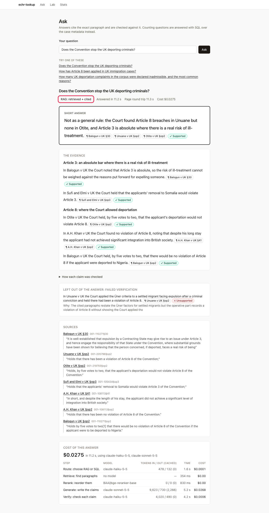

# echr-lookup

Ask questions about the UK's case law at the European Court of Human Rights (plus the Convention and the Human Rights Act 1998) and get answers where **every claim cites the exact paragraph it came from**, and a second model checks each citation. Counting questions ("how many...") go to a fixed SQL query instead of the language model, and the query is shown.

It is a learning and portfolio project: a retrieval-augmented generation (RAG) app, an evaluation harness, and an MCP server so Claude can use the same search. It runs locally; nothing is deployed.



*The Ask page for "Does the Convention stop the UK deporting criminals?": a short answer first, then grouped evidence. Each chip links to the cited paragraph, and a claim the checker could not support is shown as left out.*

## What is in it

- **Ask** (`/ask`): cited answers, or SQL counts with the query shown.
- **Case viewer** (`/case/<id>`): the cited paragraph highlighted in the judgment.
- **Lab** (`/lab`): one query through BM25, vector, fused and reranked search side by side, to see how retrieval works.
- **Stats** (`/stats`): corpus size, ingestion timings, cost per call and the evaluation table.
- **MCP server** (`py/echr_mcp`): six read-only tools (search, get paragraphs, get case, count, corpus info, check quote) for Claude Desktop, Claude Code and similar. Setup: [`docs/mcp-setup.md`](docs/mcp-setup.md).

The default corpus is a committed 98-document snapshot (96 HUDOC documents: 41 judgments, 40 decisions and 15 legal summaries; plus the Convention and the Human Rights Act). A one-off full ingest of 3,527 UK documents was also built; it stays on the author's machine.

## Run it

Requires Node 22.22, pnpm 10.34.7, uv 0.9.x and Docker.

```sh
cp .env.example .env        # add ANTHROPIC_API_KEY (answers, citation checks, eval judge)
pnpm i
docker compose up -d --wait # Postgres + pg_search (BM25) + pgvector
(cd py && uv sync --group ml)        # includes the local embedder + reranker (CPU torch)
pnpm ingest:snapshot                 # load the 98-document demo corpus (~4 min)
pnpm eval:snapshot --retrieval-only  # fill the /stats eval table (~4 min, free)
pnpm check                  # TS typecheck + lint + tests, contract tests, ruff, pytest
pnpm dev                    # web on http://localhost:3000 (WEB_PORT=3100 if taken), API on http://localhost:8000/docs
```

Then walk the two-minute demo in [`docs/demo.md`](docs/demo.md). Everything the system can do, with a try-it each: [`docs/learn/capabilities.md`](docs/learn/capabilities.md). Answers cost about $0.02 each in Anthropic usage; retrieval, search and the stats route are free.

## Layout

| Path | What |
|---|---|
| `apps/web` | Next.js (App Router) + Tailwind front end. Talks only to the API. |
| `packages/contract` | zod schemas, the single source of truth for API shapes. Exports JSON Schema to `schema/`, plus fixtures. |
| `packages/capture` | Shared Playwright screenshot helper for the learning docs. |
| `py/` | Python 3.12 (uv): `rag/{ingest,parse,index,search,answer,eval}`, `api/` (FastAPI) and `echr_mcp/` (MCP server). |
| `infra/` | `docker-compose.yml` (ParadeDB), init SQL, migrations. |
| `data/snapshot` | Small committed demo corpus. `data/raw`, `data/full` are gitignored. |
| `docs/learn` | Plain-English learning docs. Reading order: [`docs/learn/README.md`](docs/learn/README.md). |
| `docs/decisions.md` | Why things are the way they are. |

## How good is it?

Retrieval is measured on 71 draft questions (48 explain, 12 counting, 11 neutrality) over the snapshot, for 12 configurations (3 ways of cutting the text x 4 search modes). Two answer keys are used. The **original** key lists about 2 expected paragraphs per question and was written quickly by one AI agent. **v2** is a wider key built by pooling the top-10 results of all 12 configs and having a different AI judge (Claude Opus) grade every paragraph 0, 1 or 2 ([method and caveats](docs/eval-judging.md)). It is a better estimate, not the truth.

| Config | Recall@10, original | Recall@10, v2 | MRR, original | MRR, v2 |
|---|---|---|---|---|
| by_section / bm25 | 0.31 | 0.37 | 0.22 | 0.53 |
| by_section / vector | 0.30 | 0.36 | 0.22 | 0.65 |
| **by_section / hybrid** | **0.32** | **0.41** | **0.24** | **0.69** |
| by_section / hybrid_rerank | 0.32 | 0.40 | 0.18 | 0.55 |
| recursive / hybrid | 0.25 | 0.31 | 0.23 | 0.63 |
| recursive / hybrid_rerank | 0.28 | 0.32 | 0.16 | 0.54 |
| fixed / hybrid | 0.31 | 0.40 | 0.19 | 0.66 |
| fixed / hybrid_rerank | 0.32 | 0.40 | 0.19 | 0.49 |

(The four remaining configs, and recall@5 and nDCG@10, are in [`docs/eval-judging.md`](docs/eval-judging.md).) Answer-level scores for the default config: faithfulness 0.95 to 0.98, citation accuracy 0.93 to 0.94, neutrality 0.82 to 1.00 (noisy), counting questions 11/12 to 12/12 correct; see the table below.

The table the tooling regenerates (original key only):

<!-- eval:start -->
| Chunking | Mode | R@5 | R@10 | MRR | Faith. | Cite acc. | Neutral | Stat |
|---|---|---|---|---|---|---|---|---|
| fixed | bm25 | 0.19 | 0.29 | 0.18 | – | – | – | – |
| fixed | vector | 0.19 | 0.27 | 0.24 | – | – | – | – |
| fixed | hybrid | 0.18 | 0.31 | 0.19 | – | – | – | – |
| fixed | hybrid_rerank | 0.21 | 0.32 | 0.19 | – | – | – | – |
| recursive | bm25 | 0.21 | 0.24 | 0.16 | – | – | – | – |
| recursive | vector | 0.18 | 0.22 | 0.21 | – | – | – | – |
| recursive | hybrid ★ | 0.19 | 0.25 | 0.23 | 0.98 | 0.94 | 1.00 | 1.00 |
| recursive | hybrid_rerank ★ | 0.17 | 0.28 | 0.16 | 0.95 | 0.93 | 0.82 | 0.92 |
| by_section | bm25 | 0.22 | 0.31 | 0.22 | – | – | – | – |
| by_section | vector | 0.22 | 0.30 | 0.22 | – | – | – | – |
| by_section | hybrid | 0.23 | 0.32 | 0.24 | – | – | – | – |
| by_section | hybrid_rerank | 0.19 | 0.32 | 0.18 | – | – | – | – |

★ = answer-level. Details, cost and what it shows: [docs/eval-results.md](docs/eval-results.md). Question set is still in draft.
<!-- eval:end -->

## What I learned (the honest story)

- **Every gate passed, but the answers were not useful until two rounds of fixes.** The tests, faithfulness, citation accuracy and neutrality scores were all green, yet the first real question ("Does the Convention stop the UK deporting criminals?") returned a list of cited facts and no answer. Two rounds of changes followed (answer first, then honesty and clarity fixes) and cost about a third of the build. No metric detected "faithful but unhelpful"; a person using the app did.
- **The reranker did not earn its keep.** On the wider key, plain hybrid search beats hybrid plus a general-purpose reranker on ordering for all three chunkings (MRR down 0.09 to 0.17), ties on recall, and costs about 4.5 s per search on 4 vCPUs. The best configuration is by_section + hybrid.
- **Define terms before counting them.** "Deportation", "declared inadmissible" and "found a violation" each needed a written definition; the counting bugs and one disputed expected number were vocabulary problems found late.
- **The answer key was too narrow.** A second judge confirmed 116 of 148 original gold paragraphs and added 536 more, so recall numbers on the original key understate retrieval.
- **Coordination was the costly part of the build.** The AI orchestrator was about 60% of the build spend.

More, with the concrete next steps: [`docs/next-steps.md`](docs/next-steps.md). The full build story: [`docs/orchestration/retrospective.md`](docs/orchestration/retrospective.md). Why things are the way they are: [`docs/decisions.md`](docs/decisions.md).

## Data, licences and attribution

- **HUDOC case law:** © ECHR-CEDH. Texts are reproduced from the European Court of Human Rights' HUDOC database for information and education, with the source acknowledged, under the Court's [copyright terms](https://www.echr.coe.int/copyright-and-disclaimer). Only the small snapshot in `data/snapshot/` is committed; the full ingest in `data/full/` is never committed or redistributed.
- **European Convention on Human Rights:** © Council of Europe, reproduced with the source acknowledged (© ECHR-CEDH).
- **Human Rights Act 1998:** Contains public sector information licensed under the [Open Government Licence v3.0](https://www.nationalarchives.gov.uk/doc/open-government-licence/version/3/), from legislation.gov.uk.
- Per-document sources and terms: [`data/snapshot/README.md`](data/snapshot/README.md) and [`docs/hudoc-measurement.md`](docs/hudoc-measurement.md).
- This is not legal advice and is not affiliated with the Court.
