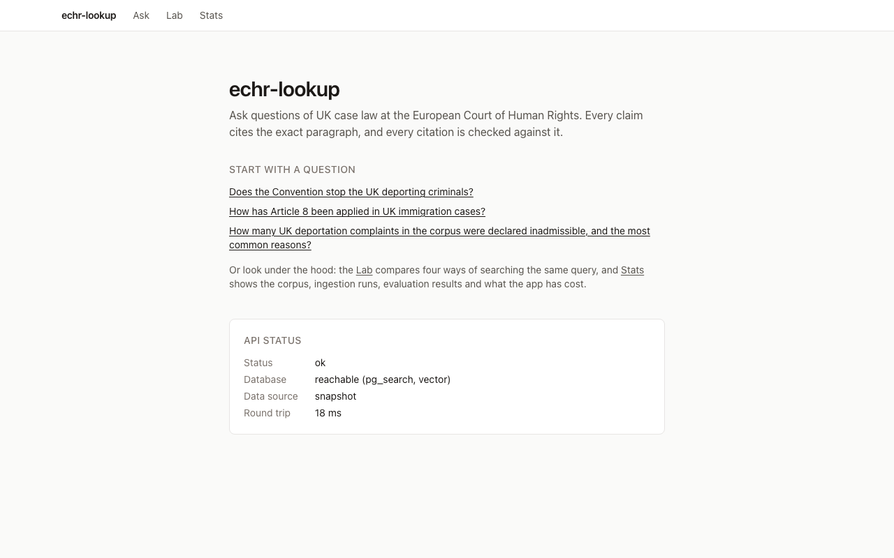
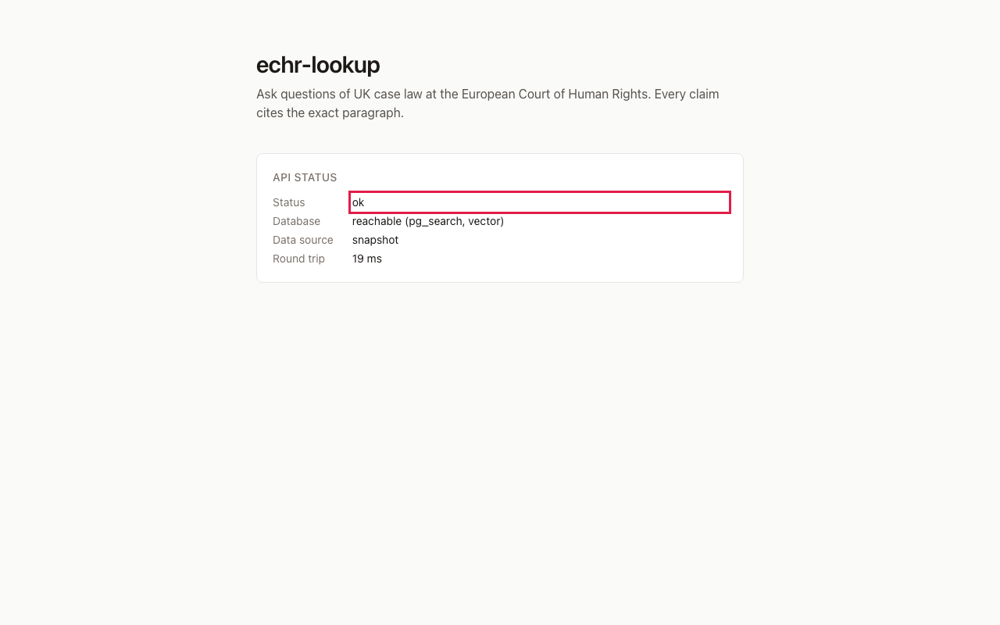
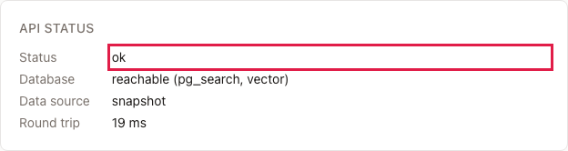

# C1: the shared screenshot helper (`packages/capture`)

## 1. What this is, in plain English

**Playwright** is a library that remote-controls a real web browser from code: open a page, click a button, type
into a box, take a picture. We use it for one job only: making the screenshots that illustrate these learning docs
(and, later, the Gate 2 web UI). A **headless** browser is one that runs without opening a visible window, which is
how Playwright works by default. **Chromium** is the open-source browser engine behind Chrome; it is the one we drive.

Instead of every task writing its own little browser script, there is exactly one helper, `packages/capture`. You
give it a **spec**: a base URL plus a list of **steps** ("go to `/`, wait for the status to say ok, take a
screenshot called `C1-home`"). It plays the steps in a headless Chromium and writes `docs/learn/img/<name>.png`.
Re-running a spec overwrites the same file names, so a screenshot in a doc can be refreshed by simply running
the spec again after the UI changes.

A **selector** is a short string that says which element on the page you mean, e.g. `h1`, `#q`,
`[data-testid=api-status]`. The `data-testid` attributes already in the web app exist so selectors stay stable when
the styling changes.

## 2. Why it matters for answer quality

It does not touch retrieval or answers directly, but it keeps the docs honest. For example, the Gate 2 teaching
screenshot for the demo question "Does the Convention stop the UK deporting criminals?" can *wait for the answer
to finish*, *highlight the citation `001-57619§88`*, and *crop to just the answer card*. The picture then shows the
real, current output: if citations break, the capture step that waits for them fails loudly instead of quietly
producing a stale picture.

## 3. How it works here

```
spec.json ──► cli.ts ──► capture() ──► (1) validate spec          steps.ts  (zod)
 pnpm capture              index.ts    (2) is baseUrl reachable?  index.ts  (clear error if not)
                                       (3) launch headless Chromium
                                       (4) play each step in order
                                       (5) screenshot step ──► <outDir>/<name>.png
```

Files in `packages/capture/`:
- `src/steps.ts`: the step types and the zod schema that validates a spec (`parseSpec`).
- `src/index.ts`: the library API `capture({ baseUrl, steps, outDir, viewport, fullPage })`, which returns the list of files written.
- `src/paths.ts`: finds the repo root; resolves `outDir` (relative paths are relative to the **repo root**).
- `src/cli.ts`: the `pnpm capture <spec.json>` command.
- `specs/home.json`, `specs/example-highlight-crop.json`: ready-made examples.
- `test/`: offline spec tests, plus an end-to-end test that serves a tiny page and captures it (skipped automatically if Chromium isn't installed).

### The spec format

```json
{
  "baseUrl": "http://localhost:3100",
  "outDir": "docs/learn/img",
  "viewport": { "width": 1280, "height": 800 },
  "fullPage": false,
  "steps": [ ... ]
}
```
Only `baseUrl` and `steps` are required; the rest show their defaults. The first step must be `goto`, and there must be at least one `screenshot`.

| Step | Fields | What it does |
|---|---|---|
| `goto` | `url` | Open a URL (`/ask` is resolved against `baseUrl`; a full URL also works) |
| `click` | `selector` | Click the first match |
| `fill` | `selector`, `value` | Type into an input |
| `press` | `key`, optional `selector` | Press a key such as `Enter` (on the element, or on the page) |
| `wait` | `ms` | Sleep (use `waitFor` when you can) |
| `waitFor` | exactly one of `selector` / `text`, optional `timeoutMs` | Wait until the element or text appears (default 15 s) |
| `highlight` | `selector`, optional `color` | Draw a red outline around the element (stays for later screenshots) |
| `screenshot` | `name`, optional `selector` (crop), optional `fullPage` | Save `<name>.png` |

Notes:
- `name` is a plain file stem (letters, digits, `.`, `_`, `-`). Convention: prefix with your task id, e.g. `C1-home`.
- The Next.js dev-mode badge (the round "N" bottom left) is hidden in every screenshot.
- To point a spec at another server without editing it: `pnpm capture <spec> --base-url http://localhost:3000` (or set `CAPTURE_BASE_URL`).
- Use it from code: `import { capture } from "@echr/capture"`.

### One-time setup

```
pnpm i
pnpm --filter @echr/capture exec playwright install chromium
```
The second command downloads the browser (about 150 MB). It is deliberately **not** part of `pnpm check`, so CI stays fast; the browser-based test skips itself when Chromium is missing.

## 4. Try it

Port 3000 is used by another app on this machine, so start the app on 3100. In one terminal: `WEB_PORT=3100 pnpm dev`.

1. **Capture the home page.**
   Run `pnpm capture packages/capture/specs/home.json` → prints `wrote docs/learn/img/C1-home.png`; open it and you see the echr-lookup page with the API status card showing `Status: ok` → proves the helper can drive the real app. The spec *waits for* the status to read `ok`, so if the API is down it fails (`Step 2 … failed`) instead of saving a picture of an error.

   

2. **Highlight an element.**
   Run `pnpm capture packages/capture/specs/example-highlight-crop.json` → open `docs/learn/img/C1-home-highlight.png`; the `ok` value has a red rectangle around it → proves `highlight` can point a reader at the one thing that matters.

   

3. **Crop to a selector.**
   The same command also wrote `docs/learn/img/C1-home-crop.png`, which contains only the API status card, not the full page → proves `screenshot` with a `selector` crops to an element.

   

4. **Write your own spec.**
   Create `/tmp/mine.json` containing `{"baseUrl":"http://localhost:3100","outDir":"/tmp","steps":[{"action":"goto","url":"/"},{"action":"highlight","selector":"h1","color":"blue"},{"action":"screenshot","name":"mine"}]}`, then run `pnpm capture /tmp/mine.json` → `/tmp/mine.png` shows the title outlined in blue → proves specs are plain data and any task can make its own without new browser code.

5. **See the failure messages.**
   Stop `pnpm dev` and re-run test 1 → `Could not reach http://localhost:3100 … Is pnpm dev running on localhost:3100?`. Then restart it and change `home.json`'s `waitFor` selector to `#nope` → `Step 2 (...) failed: locator.waitFor: Timeout 15000ms exceeded` → proves failures are explicit and name the step. (Revert the edit afterwards.)

6. **Run the tests.**
   `pnpm --filter @echr/capture test` → all pass in a couple of seconds; the "end to end" group runs only if Chromium is installed → proves the helper works against a local test page without needing the app.

## 5. Limits / what can go wrong

- **Chromium must be installed once** (command above), or you get "Could not start Chromium … Install it once with …".
- **Dynamic content changes between runs** (e.g. "Round trip 19 ms"), so PNGs will differ byte-for-byte after each re-run even when nothing is wrong. Git will show them as modified; that is expected.
- **No pixel-comparison or video**; this is for documentation pictures, not visual regression testing.
- A selector matching several elements uses the **first** one.
- **Fixed viewport** (1280×800 by default): responsive layouts need a second spec with another `viewport`.
- The helper only reaches pages that are already running; it never starts the app for you.
- `waitFor` with `text` matches a substring of any visible text on the page; prefer a selector when the page repeats the word.
