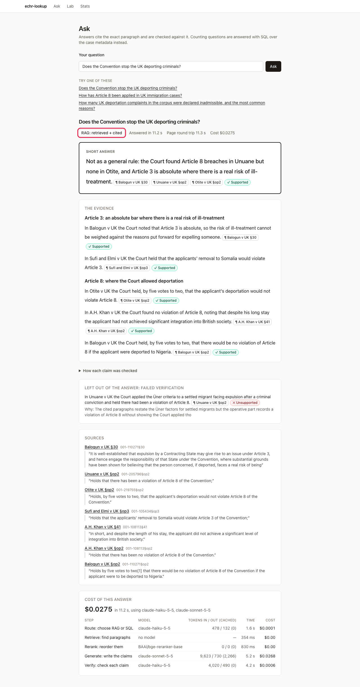
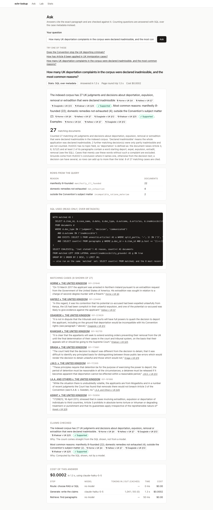
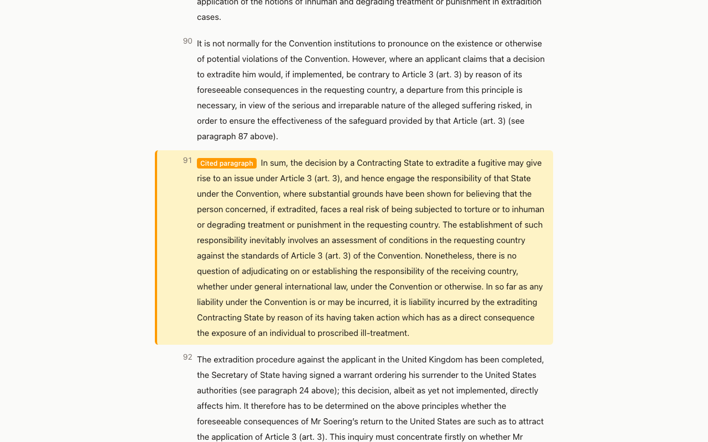

# I1: Ask + case viewer (and the shared layout)

## 1. What this is, in plain English

This is the screen where a question turns into an answer you can check. You type a question on **/ask**. The
app finds the most relevant paragraphs of ECHR case law, asks a language model (an LLM, such as Claude) to write
short **claims** based only on those paragraphs, and then asks a second, cheaper model to check each claim
against the paragraph it cites. That whole pattern (retrieve text, generate from it, cite it) is called
**RAG**, Retrieval-Augmented Generation. The page shows you the result *and the evidence for trusting it*.

The answer **starts with a boxed "Short answer"**: one sentence that answers the question directly ("Not as a general
rule: …"), with its own chips and badge. Under it, **The evidence** lists the supporting points, grouped under short
neutral headings such as "Where the Court found a breach" and "Where the Court allowed the State's action". (Older
answers, and answers to value questions such as "Should the UK leave the ECHR?", have no short answer or headings and
are shown as one block of text, as before.)

Two things on the page do the trust work:

- A **citation chip** such as `¶ Soering v UK §86 Judgment` sits after the claim it supports. `§86` is paragraph 86 of that
  judgment, and the small tag (*Judgment*, *Decision*, *Communicated case*, *Legal summary*, *Legislation*) says what kind of
  document it comes from. A **legal summary** is highlighted in amber and, in the source list, labelled "A summary written
  by the Court's staff, not the judgment itself", so it can never pass for the judgment. Click the chip and you land on **/case/001-57619#p86**, the full judgment with that one paragraph
  highlighted, so you can read the claim and its source side by side.
- A **verification badge** (`✓ Supported`, `✕ Unsupported`, `? Unverified`) says what the checker concluded.
  *Supported* means the cited paragraph backs the claim. *Unsupported* means the checker found that it does not;
  such a claim is **left out of the answer text** and listed separately under "Left out of the answer", so you
  can see what the model tried to say and that it was caught. *Unverified* means no check was run. Hover or
  focus a badge to read the checker's reason. Each badge has a symbol and a word, so it never relies on colour.

Counting questions ("how many…") take a different road. A language model reading ten search hits cannot count a
corpus reliably, so the **router** (the first step, which picks a route per question) sends them to the **stats
route**: it writes a read-only **SQL** query over the case metadata (outcome, articles, inadmissibility grounds),
runs it in Postgres and shows you the count, the rows, the exact SQL and the matching cases. The count comes from
the database, not from a model's memory.

Two more things keep the page honest about scope. Under the Ask heading a **corpus line** says what is searched, taken
live from `GET /stats` (the same source as the Stats page): for example "Searching 98 documents: United Kingdom cases at
the European Court of Human Rights only (judgments, decisions, communicated cases and legal summaries), plus 2 legislation
texts." For the committed snapshot it adds that this is a small sample, so when a question gets no answer the Court may
still have decided it in a case that is not here (a refusal says the same: it does **not** mean the Court never decided
it). If the stats call fails, the line still says "UK cases only" but shows no numbers. And under each answer an
**Ask next** box offers two or three **follow-up questions** built from the cases and Articles the answer cites, plus a
field for your own. Each is a plain link to a fresh `/ask?q=…`: every question is answered on its own and nothing from the
previous answer is remembered or sent along.

On the stats route the page shows both numbers when a question asks for a total *and* a subset ("10 Grand Chamber
judgments; 9 of them found at least one violation", with "of the 10 counted documents have the outcome asked about"
beside the big number). The cases below the count are labelled **Examples of matching cases**, with the note "Illustrations
only: the count above comes from the SQL, not from these paragraphs", and a case with no paragraph that states the counted
outcome is listed without a quote.

Under every answer is the **route taken**, the time, and **what it cost**, step by step. Seeing a typical answer
cost about two to three cents, and where the money goes (the "generate" step), is part of understanding RAG.

## 2. Why it matters for answer quality

Take the first demo question, "Does the Convention stop the UK deporting criminals?". A plain chat model might
say "yes, Article 3" with total confidence. Here the answer opens with a direct, hedged sentence and then has to survive
three tests you can see: each claim has chips pointing at real paragraphs (for example *Chahal v UK §op1* and *Ndidi v UK §op2*,
the Court's own operative findings), the checker marks each claim, and the answer includes cases where deportation was
allowed (*Ndidi*, *Otite*) as well as ones where it was blocked (*Chahal*, *A.A.*, *Unuane*). An earlier version listed
cited facts with no direct answer and opened with the text of an immigration statute; the current one puts the bottom line first and
keeps recited legislation out of the way. If a claim were invented, it would either have no chip, or its chip would open a
paragraph that says something else, which is exactly the doubt this UI is designed to let you act on.

## 3. How it works here

```
browser ──GET /ask?q=…──▶ Next server (apps/web)  ──POST /ask──▶ FastAPI (py/api) ──▶ Postgres
   ▲                         │  renders the shell at once          route → retrieve → rerank
   │  streams the answer     │  <Suspense> "Thinking…"              → generate → verify
   └─────────────────────────┘  AnswerPanel awaits ask()
browser ──GET /case/<id>#p<ref>──▶ Next server ──GET /case/<id>──▶ FastAPI ──▶ Postgres
```

- `apps/web/app/ask/page.tsx`: a plain `<form method="get">` (so every answer is a linkable URL), the three demo
  questions, and a `<Suspense>` boundary around a server component that calls `ask()` from `@/lib/api`. The page
  shell appears immediately; the answer streams in after 5–10 s. No client-side fetching, no secrets in the browser.
  Reloading a URL asks again (and, in live mode, pays again).
- `apps/web/components/answer-display.ts`: the display logic as pure, tested functions. `isAnswerFirst()` and
  `answerFirstLayout()` pick the new layout (when any claim has `role` or `group`) and split the claims into the short
  answer, the points under their headings (consecutive points with the same `group`), and any claim that failed
  verification (shown apart, "Left out of the answer"). `segmentAnswer()` splits
  `answer_text` back into claims by locating each claim's text, replaces the `[Case §88]` markers with chips built
  from `claim.citation_ids`, and returns the claims that are not in the text (dropped as unsupported). If a claim's
  text is only the start of a sentence, or is worded differently, its chips go at the end of the sentence that best
  matches it, never mid-sentence. `statsCell()` shows plain labels for the stats table (the raw key stays beside it in
  small monospace). Also
  `chipRef` / `chipLabel` / `docTypeShortLabel` (the chip text with its document type), `followUpQuestions()` (the
  two or three follow-ups: none after a refusal, no repeat of the question just asked), `displayQuote()` (adds "…" where a
  quote starts or stops mid-sentence, which only happens when one sentence was longer than the quote budget),
  `formatCost`, `routeLabel`.
- `apps/web/components/corpus-scope.tsx`: `corpusScope()` (pure, tested) turns `CorpusStats` into the corpus line;
  `follow-ups.tsx`: the "Ask next" box. `app/ask/page.tsx` fetches `getStats()` in its own `<Suspense>` so the line never
  delays the answer.
- `apps/web/components/answer-view.tsx`, `answer-text.tsx`, `stats-answer.tsx`, `cost-breakdown.tsx`,
  `citation-chip.tsx`, `claim-badge.tsx`: the rendering (RAG, stats, refused, cost table).
- `apps/web/app/case/[id]/page.tsx`: header (name, date, type, chamber, articles, outcome, importance, ECLI, HUDOC
  link), then every paragraph in order, grouped by section, each `id="p<ref>"`. `case-display.ts` holds the grouping
  and labels. Highlighting works in two layers: CSS `:target` (no JavaScript needed) and
  `components/highlight-target.tsx`, a tiny client component that scrolls to the hash and sets
  `data-highlighted="true"`, and follows hash changes.
- Every API failure (`ApiResult.ok === false`) renders through `components/error-notice.tsx`.

## 4. Try it

Start the API and web app (see `docs/interfaces.md` §10), then:

1. **A cited answer.** Open `/ask`, click the first example (or `/ask?q=Does the Convention stop the UK deporting criminals?`).
   You see "Thinking… (usually 5–10 s)", then a boxed **Short answer** with a chip and ✓ badge, **The evidence** below it in
   groups (for example "Where the Court found a breach" / "Where the Court allowed the State's action") with chips and ✓ badges, the
   line "RAG: retrieved + cited", and a cost table. *Proves:* the answer states what the Court has done first, then shows the
   cases, and each claim was checked. Every chip carries its document-type tag, and under the answer an **Ask next** box
   offers follow-up questions (click one: it opens `/ask?q=…` as a new question).
2. **Check a claim yourself.** Click any chip. You land on the case with that paragraph shaded and labelled "Cited paragraph".
   Read it, then read the claim. *Proves:* the citation is a real paragraph, and you can judge the match; the badge is a second opinion, not the last word.
3. **The counting route.** Open the third example. You see "Stats: SQL over metadata", a big count, a table of reasons (plain words such as "domestic remedies not exhausted", with the raw key beside it), the SQL in a
   dark block, the matching cases and a cost of well under a cent. *Proves:* counts come from a query you can read and re-run.
4. **A refusal.** Ask `What is the Court's view on a UK exit from the Convention?`. You get a calm "No answer from the sources" card that
   adds "That does not mean the Court has never decided it: this library holds only United Kingdom cases, and may hold only a sample".
   *Proves:* the system declines rather than invents, and does not claim the Court is silent.
5. **No-JavaScript highlight.** Open `/case/001-57619#p91` with JavaScript disabled. Paragraph 91 is still shaded (CSS `:target`).
   *Proves:* the highlight does not depend on the script.
6. **Errors are readable.** Open `/case/001-99999`: "No case with that id" and a "Back to Ask" link (the page's HTTP status is 404: `curl -s -o /dev/null -w '%{http_code}' localhost:3101/case/001-99999`). Stop the API and reload `/ask?q=hi`: "Can’t reach the API".
   *Proves:* failures are explained, not a blank page.

7. **What the library holds.** Open `/ask` and read the line under the heading → "Searching 98 documents: United Kingdom cases … only (…)" and, on the snapshot, "This is the small committed sample, not the full HUDOC download …" with a "What's in it →" link to `/stats`. Offline: `cd apps/web && pnpm exec vitest run ask-extras` → 8 tests pass (the line, the failed-stats case, the document-type tags, the follow-up links, the "…" on cut quotes). *Proves:* the scope is stated from live data, never hard-coded, and a failed stats call hides the numbers rather than inventing them.

Screenshots:   

## 5. Limits / what can go wrong

- **The short answer is a summary, not the law.** It reports what the Court held in the cases cited under it, and the checker
  reads it against those paragraphs together. If the checker rejects it (and a rewrite also fails) the page shows only the
  evidence, and the sentence appears under "Left out of the answer".
- **"Supported" is a model's opinion.** The checker is a smaller model reading the claim and the paragraph. It can be wrong in either
  direction, so the chip (your own reading) is the real test. "Unsupported" means the checker disagreed with the model that wrote the
  claim; that claim is hidden from the answer text but shown below it.
- **Chips cover the paragraphs the model chose.** An answer can be accurate but one-sided if retrieval returned mostly one kind of case;
  the UI shows what was cited, not what was missed.
- **Quotes are trimmed snippets** (about 300 characters) from the paragraph, not the whole paragraph. They are runs of whole
  sentences that contain the supporting one; a "…" marks the rare cut inside an over-long sentence.
- **Follow-ups are templates, not model output.** They are built from case and Article names in the answer ("What did the Court decide in X, and why?"),
  so they are always askable but sometimes generic; they do not know what you asked before.
- **The corpus line says "sample" only for the snapshot** (`data_source` in `/stats`). A full corpus is still not "all case law": it is UK cases only.
- **Stats examples are not the evidence.** A count of violations may list a case without a quote when none of its operative clauses states one.
- **The stats route only counts what metadata and decision text say.** Inadmissibility grounds are often extracted from text, and the
  explanation line under the count states the definition used.
- **Live answers cost money and vary.** The same question can word differently on each ask. A reload asks again.
- The snapshot corpus is small, so a good question can still end in "not in the sources".
