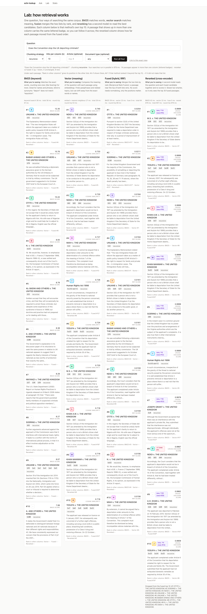

# I2: the Lab (retrieval, side by side)

The most important page for understanding what this project does. Everything on `/lab` is real output from the running API on the snapshot corpus (96 cases, about 5,900 `recursive` chunks).

## 1. What this is, in plain English

RAG (Retrieval-Augmented Generation) means: before the model writes an answer, we *retrieve* the few passages most likely to contain it, and the model may only cite those. Retrieval is the step that decides what the model gets to see, so it is where most wrong answers start. The **Lab** page runs one question through four retrieval methods at the same time and lays the results out as four columns, so you can see how each works and how they disagree.

- **BM25** is *keyword* search. It scores a passage by how many of the query's words it contains, counting rare words (*Soering*) for much more than common ones (*the*). It is excellent at names and exact phrases and has no idea what words *mean*.
- **Vector search** is *meaning* search. An **embedding model** turns every passage (and the question) into a list of 384 numbers, a **vector**, so that texts about the same thing end up close together. The score is **cosine similarity** (how closely two vectors point the same way: 1 is identical). It finds paraphrases, but can drift to something that merely sounds related.
- **Fused** (hybrid) merges the two lists with **Reciprocal Rank Fusion (RRF)**. Each passage gets `1 / (60 + rank)` from every list it is in, and the points are added. Only *positions* count, never the raw scores, so BM25's unbounded numbers and cosine's 0.7 to 0.8 never have to be made comparable.
- **Reranked** takes the top 30 fused passages and has a **cross-encoder** (a model that reads the question and a passage *together*) give each a relevance score. It is slower (about a second) and much more discriminating than the first three, which compare a question to a passage only through numbers computed separately.

Under all of it is **chunking**: before anything is searched, each case is cut into **chunks** (passages of a few paragraphs). Three strategies exist: `fixed` (about 256-token windows that ignore paragraph boundaries), `recursive` (splits at paragraph and sentence boundaries, the default) and `by_section` (follows the judgment's own headings, so chunks are bigger). A **token** is roughly three quarters of a word, in the embedder's own vocabulary.

On the page, a passage that appears in more than one column wears the same **lettered badge** (A, B, C…, with a colour as a second cue). In the reranked column, each passage also shows how far it moved from the fused order: `↑3`, `↓2`, or `new` (it was not in the fused top k; the tag then tells you where it was, e.g. `new, ↑19 (was #26)`).

## 2. Why it matters for answer quality

Open the demo question, *"Does the Convention stop the UK deporting criminals?"*, ([screenshot](img/I2-lab-q1.png)):



- **BM25's #1 is not what it looks like.** *UNUANE v UK* §32 quotes the government's Explanatory Memorandum to the Immigration Rules ("will reform the approach taken as a matter of public policy towards ECHR Article 8…"). It scores highest on keywords (BM25 12.4, the next is 10.8) but it is a policy statement, not the Court's reasoning. The cross-encoder reads it and ranks it **25th of 30** (score 0.0018). Keywords alone would have sent a passage about rule-making to the answer step.
- **RRF's #1 is a compromise.** *OTITE v UK* §10 is fused #1 although BM25 had it only 11th and vector 28th: it was on both lists, and agreement beat being first on one. The reranker moves it to **#12**. RRF rewards "both methods noticed it", not "it answers the question".
- **The reranker's #1 was invisible to BM25.** *M.S. v UK* §10 to §12 (the statutory framework for deporting a foreign national) is vector #7, **not in BM25's top 50 at all**, and only fused #15. It is reranked #1. Without the reranker and a wide enough candidate pool, it would never reach the answer step.
- In this run, of the reranked top 10, **nine were not in the fused top 10** (`new`). The reranker works from the fused top 30, so a good passage at fused #15 can be rescued. It also shows the ceiling: a passage outside the fused top 30 cannot be.

The answer step (`/ask`) uses `hybrid_rerank`. This screen is the reason you can trust or doubt that step: you can see exactly which passages it was offered and why.

## 3. How it works here

```
browser ──GET /lab?q=…&chunking=recursive&k=10──► Next.js server (app/lab/page.tsx)
                                                    │  parseLabParams()  (invalid values fall back to defaults)
                                                    │  four POST /search calls in parallel (Promise.all):
                                                    │     bm25 · vector · hybrid · hybrid_rerank
                                                    ▼
                                                  FastAPI /search ──► Postgres (pg_search BM25 index, pgvector HNSW index)
                                                    │                 + embedder + reranker, loaded once in the API process
                                                    ▼
                                                  four SearchResult objects ──► assignBadges / rankMovements ──► HTML
```

Files (all under `apps/web/app/lab/`):

- `page.tsx`: the server component. Reads the URL, makes the four searches, builds the cross-column context, renders.
- `lab-model.ts`: all display logic as pure functions (tested in `lab-model.test.ts` on `SearchResult.json`): `parseLabParams`, `buildRequest`, `scoreOf` (labels each column's own score: BM25 score, cosine similarity, RRF score, cross-encoder score), `rankMovements` (fused to reranked), `assignBadges`, `ranksAcrossColumns`, `rerankDisabled`, `timingText`, `snippet`, `paragraphLink`.
- `_components/lab-form.tsx`: a plain GET `<form>`, so every view is a shareable URL.
- `_components/lab-column.tsx`: one column, including the readable error and "reranking is off" states (`lab-column.test.tsx`).

**Why four calls, not one.** A single `hybrid_rerank` call returns only the top k *after* reranking. Its hits do carry BM25 and vector ranks, but only for chunks in its own candidate pool; it cannot tell you what BM25 alone would have put in its top 10. So the page asks each method for its own top k (the exact thing the column claims to show) and uses the extra rank fields on the fused and reranked hits only to fill gaps (`#26*` means "that method ranked it 26th, beyond the top k shown").

The numbers shown mean different things: BM25 scores are unbounded and query-dependent; cosine is roughly 0.7 to 0.8 for decent matches here; RRF scores are tiny by design (about 0.016 to 0.033); the cross-encoder score runs 0 to 1 and **saturates** (several top passages sit at 0.9999, so the page shows four decimals). Compare *ranks* inside a column, never scores across columns.

Timings, from `SearchResult.timings_ms`, are shown per column, plus the round trip. Warm, on this machine: BM25 ≈ 40 ms, vector ≈ 40 ms, fused ≈ 80 ms, reranked ≈ 0.9 to 1.6 s (the reranker dominates). The page renders in about 1.1 s in `next dev`.

## 4. Try it

Start the API and web (see `docs/interfaces.md` §10; for I2: `API_PORT=8002 pnpm dev:api`, then `API_URL=http://localhost:8002 WEB_PORT=3102 pnpm dev:web`). The first search after a start takes a few extra seconds while models load.

1. **The demo question.** Open <http://localhost:3102/lab>. → four columns, ten hits each, with the demo question pre-filled. Find the lettered badges and follow one across columns; read the "Rank in other columns" line under it. In the reranked column look for `new, ↑N` tags. → *Different methods surface different paragraphs; the final order differs from the fused order.*
2. **Names: BM25's home turf.** <http://localhost:3102/lab?q=Soering&k=5>. → BM25's #1 is a *Soering* passage, but its #2 and #3 are *Harkins and Edwards* and *Babar Ahmad* passages that merely *quote* Soering, and the scores are close (6.2, 6.1, 6.1): a rare word counts a lot wherever it appears. Vector search returns only *Soering* passages in its top 5, but with weak similarity (0.61 to 0.63, against 0.72 to 0.74 for the paraphrase in step 3). → *A bare name carries little meaning for the embedder; for BM25 it is gold.*
3. **A paraphrase: vector drifts, BM25 and the reranker don't.** <http://localhost:3102/lab?q=is%20it%20cruel%20to%20keep%20a%20condemned%20prisoner%20waiting%20for%20execution&k=5> ([screenshot](img/I2-lab-paraphrase.png)). → BM25 returns four *Soering* passages about death row (the words "condemned prisoner" match). Vector's top three are *Vinter* (whole-life sentences) and *Babar Ahmad*: the right *topic* (Article 3, severity of punishment), the wrong *facts*. The reranker's #1 is a *Soering* §100 passage (fused #26) that BM25 did not have in its top 50 at all. → *Each side makes mistakes the other doesn't; fusion plus reranking recovers.*
4. **RRF arithmetic.** On the page from step 1, pick a fused hit and read its two ranks from the "Rank in other columns" line, then check: a passage at BM25 #11 and vector #28 has `1/71 + 1/88 ≈ 0.0254` (this is *OTITE* §10, the demo's fused #1). → *Fusion is only rank arithmetic.*
5. **Chunking changes what exists to be found.** Compare <http://localhost:3102/lab?chunking=fixed>, <http://localhost:3102/lab?chunking=recursive> and <http://localhost:3102/lab?chunking=by_section> (same question). → The reranked #1 is *A. and Others* §146 to §148 for `fixed` (a 256-token window that starts mid-sentence), *M.S. v UK* §10 to §12 for `recursive`, and *A. and Others* §u7 to §u8 for `by_section` (270 tokens; chunks are larger, one reaches 462). Same corpus, different winners. → *Chunking decides what a "passage" is, which decides what can be cited.* Also note `by_section` is slower (about 1.8 s page load): the reranker reads longer text.
6. **Filters.** <http://localhost:3102/lab?q=deporting%20a%20criminal%20who%20has%20family%20in%20the%20UK&article=8&doc_type=judgment&k=5>. → Every hit is from an Article 8 judgment, and all four columns are still full, because filters are applied inside each search, not after it.
7. **Errors.** Stop the API and reload. → Four readable "This search failed. … Could not reach the API" boxes instead of a crash.

## 5. Limits / what can go wrong

- **The demo question retrieves statute-description passages.** Many of the reranked top 10 for it are passages quoting section 3(5)(a) of the Immigration Act 1971 (*M.S.*, *Khan A.W.*, *Ndidi*) rather than the Court's Article 3 / Article 8 reasoning (the proportionality balance in *Ndidi* §§82 to 84 is in the lists, but only at reranked #8). The question is short and abstract; the answer step relies on this list, so retrieval quality for it is a real weakness, and the Lab is where you see it. (S6's eval measures this.)
- **The reranker only sees the fused top 30.** If the right passage is fused #31 it cannot be rescued, and the Lab cannot show it: the Lab's "new" tag only ever says *it was somewhere in the top 30*.
- **Cross-encoder scores saturate.** Several passages at 0.9999 are effectively tied; their order among themselves is noise.
- **"–" in "Rank in other columns" means "not among that column's top k"**, not "not found at all"; `#n*` shows a rank beyond k when the fused or reranked hit carried it, but a passage that appears only in the BM25 column never reveals its vector rank.
- **Four searches per page view.** The three cheap searches repeat work the reranked search does internally (it runs its own BM25 and vector). That is deliberate, to show each method's own top k; it costs nothing in money (all models are local) but means a page view is four API calls.
- **The reranked column dominates latency** (≈ 1 s; `by_section` ≈ 1.8 s). If the API is cold (models not yet loaded) the first view is slower.
- **No snapshot of live data:** results come from the API's database at request time; if the corpus is re-ingested the batches change, and the examples above may shift slightly. All examples here were measured on the snapshot.
- **Reranking can be turned off** (`RERANK_ENABLED=0`): the reranked column then says so and repeats the fused order.
