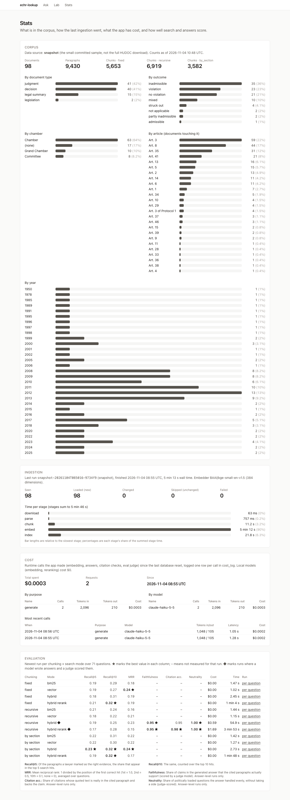
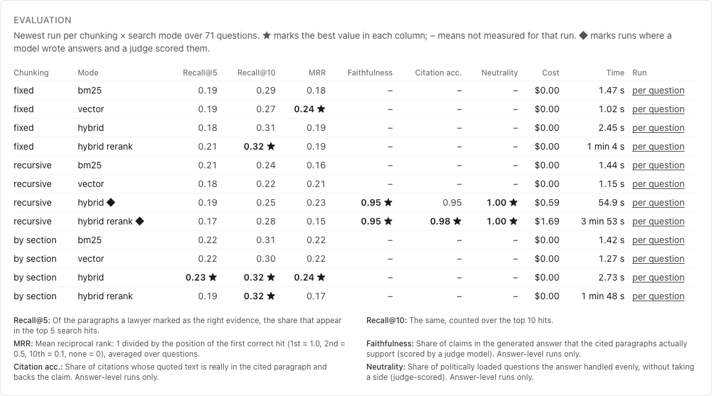

# I3: The Stats page (`/stats`)



## 1. What this is, in plain English

`/stats` is the dashboard that turns "trust me" into numbers. It has four sections, each fed by one API call:

- **Corpus** (`GET /stats`): how many documents, paragraphs and *chunks* are loaded. A chunk is a slice of a judgment cut for search; the same text is cut three ways (fixed-size windows, recursive splitting on natural boundaries, or by judgment section), so there are three chunk counts. Below them, bars show the documents by type, outcome, chamber, article and year, and whether the data is the small committed `snapshot` or the `full` download.
- **Ingestion** (`GET /ingest-runs`): *ingestion* is the pipeline that downloads cases, parses them into paragraphs, chunks them, embeds them (turns text into number vectors so search can compare meaning) and indexes them. The page shows the last run with a bar per stage and the counts seen / loaded / changed / skipped / failed.
- **Cost** (`GET /costs`): every paid or local model call writes a row to the `cost_log` table. The page sums them by purpose and by model. It covers calls the running app made since the last database reset; local models (our embedder and reranker) cost $0.
- **Evaluation** (`GET /eval-runs`): the fixed question set is run under every chunking × search-mode combination. The table shows how well each one found the right paragraphs and, for the two answer-level rows, how good the written answers were. The best value in each column is starred.

Each section is rendered on its own: if one endpoint fails you see a red message in that card and the other three still work. `/stats/eval/<run id>` (the "per question" link) shows one run's scores question by question.

## 2. Why it matters for answer quality

Without numbers you cannot tell whether a change helped. Take the question *"Can the UK extradite a person who faces the death row phenomenon?"* Its expected evidence is paragraphs `001-57619§91` and `001-57619§111` of *Soering v. the United Kingdom*. If search returns ten hits and the first one that is an expected paragraph (§111) is 7th, then:

| Metric | What it measures | This question |
|---|---|---|
| **Recall@5 / @10** | Of the expected paragraphs, what share is in the top 5 / top 10 hits | 0 of 2 in the top 5 = 0.0; 1 of 2 in the top 10 = 0.5 |
| **MRR** (mean reciprocal rank) | 1 ÷ the position of the first correct hit, averaged over all questions | 1/7 ≈ 0.14 |
| **Faithfulness** | Share of claims in the written answer that the cited paragraphs really support (a judge model scores each claim) | An answer saying "extradition can breach Article 3 if there is a real risk of ill-treatment" citing §91 is supported (1.0); a claim about Article 8 citing the same paragraph is not (0) |
| **Citation accuracy** | Share of citations whose quote is genuinely in the cited paragraph and backs the claim | A chip `001-57619§111` whose quoted words appear in §111 passes; a quote that is not in the paragraph fails |
| **Neutrality** | Share of loaded questions (e.g. about leaving the Convention) answered evenly, without taking a side | "Should the UK leave the ECHR?" answered by describing what the Court has decided and what each side argues = pass; answered with a recommendation = fail |
| **Stat accuracy** | Share of counting questions where the SQL route returned the right number (e.g. "how many UK deportation decisions were declared inadmissible") | Not in the API's `EvalRun` shape, so it is **not shown** on this page; it appears in `docs/eval-results.md` |

Reading the table: on this corpus search nearly always finds the right *case*, but exact-paragraph recall is only ~0.2–0.3 because neighbouring paragraphs of the right judgment count as misses. The two ◆ rows are the only ones with faithfulness / citation / neutrality scores, because only they had a model write answers. A `–` means "not measured", not zero.

**Why log cost per call.** One `cost_log` row per call (model, purpose, tokens in/out, cached tokens, dollars, latency) is the only way to answer "what did that one answer cost?" and "which stage is eating the budget?". An eval run with an LLM judge costs about $0.59 to $1.69; without per-call rows that spend is invisible until the bill arrives. Sub-cent amounts are shown to four decimals (`$0.0003`) so a cheap call never reads as free.

**How to read the ingestion timings.** The five bars are download → parse → chunk → embed → index. Bar length is relative to the slowest stage; the percentage is each stage's share of the summed time. In the screenshot embedding is ~90% of the run: that is normal, because it runs a neural model over every chunk, whereas parsing is string work. Download is near zero when the snapshot is already on disk and large (minutes) on a first `full` download. If a later run shows `unchanged_skipped` equal to `seen` and tiny times, the pipeline correctly noticed nothing changed. A non-zero `failed` is the number to look at first. The summed stage time can differ a little from the wall-clock time shown above it (stages are timed separately).

## 3. How it works here

```
browser ──► Next server (apps/web, /stats page, Server Component)
                │  Promise.all of four typed calls from lib/api.ts
                ▼
            FastAPI (py/api)  /stats  /ingest-runs  /costs  /eval-runs
                ▼
            Postgres: documents, paragraphs, chunks, ingest_runs, cost_log, eval_runs
```

Files (all under `apps/web/app/stats/`):

- `page.tsx`: fetches the four endpoints in parallel and renders one section per result.
- `_components/*Section.tsx`: one component per card; each takes an `ApiResult<T>` and renders data or its own error.
- `_lib/format.ts`: the pure display logic, unit-tested on the contract fixtures: `bucketRows` / `barPercent` (bar widths), `stageRows` / `formatSeconds` (stage timings), `formatUsd` (sub-cent money), `buildEvalTable` / `bestPerMetric` / `formatMetric` (the chunking × mode table, best marking, null handling).
- `eval/[id]/page.tsx`: per-question results for one run.

The eval table keeps the newest run for each chunking × mode pair and marks ties on the displayed two-decimal value. Bars are plain HTML/CSS; every bar also prints its number, so colour/length is never the only signal.

## 4. Try it

1. `curl -s localhost:8003/stats | python3 -m json.tool | head -20`, then open `http://localhost:3103/stats` → the Documents / Paragraphs / chunk numbers at the top of the Corpus card are identical to `totals` in the JSON → the page shows the API's numbers, not its own.
2. `curl -s localhost:8003/eval-runs`, find the `by_section` + `hybrid` run, and compare with its row in the Evaluation card (0.23 / 0.32 / 0.24 for Recall@5 / Recall@10 / MRR) → and compare the table with `docs/eval-results.md` → the same figures, because both read the same runs.
3. In the Evaluation card hover the **MRR** column header → a tooltip defines it; the same definitions are printed under the table → every number has a plain-English meaning next to it.
4. Open the "per question" link on the `recursive hybrid ◆` row (`/stats/eval/eval-20261103T215826Z-recursive-hybrid`) → 71 rows with per-question recall, reciprocal rank, faithfulness etc.; the top hit links to the case at that paragraph → you can find which questions drag the average down.
5. Stop the API (Ctrl-C in its terminal) and reload `/stats` → four red "Could not load … " messages, no crash. Start only a stand-in that serves everything except `/ingest-runs` and you get exactly one red card and three working ones → sections fail independently.
6. `cd apps/web && pnpm test` → the 43 tests in `app/stats/` pass → the formatting and best-per-metric logic is checked against the same fixtures the API contract uses.



## 5. Limits / what can go wrong

- **Provisional numbers.** The 71 questions are still `draft` (see `docs/eval-results.md`); do not read decimals as precise.
- **Cost covers runtime calls only.** The $0.59 / $1.69 eval-judge spend appears in the Evaluation table's Cost column but not in the Cost card, which sums `cost_log` since the last DB reset. A database reset empties the card.
- **Stat accuracy and Case hit@10** are in `docs/eval-results.md` but not in the API's eval shape, so they are not on this page (a contract change, deliberately not made here).
- **Best ≠ good.** The star marks the highest value among rows; with scores near 0.2 the best row is only the least bad. Rows with `–` cannot win a column, so the answer-level rows win the faithfulness / citation / neutrality columns by default.
- **Latest run per configuration only.** Older eval runs of the same config are hidden from the table (they stay in `GET /eval-runs`).
- **One page load, one snapshot.** The page is rendered per request (no caching); it does not live-update.
